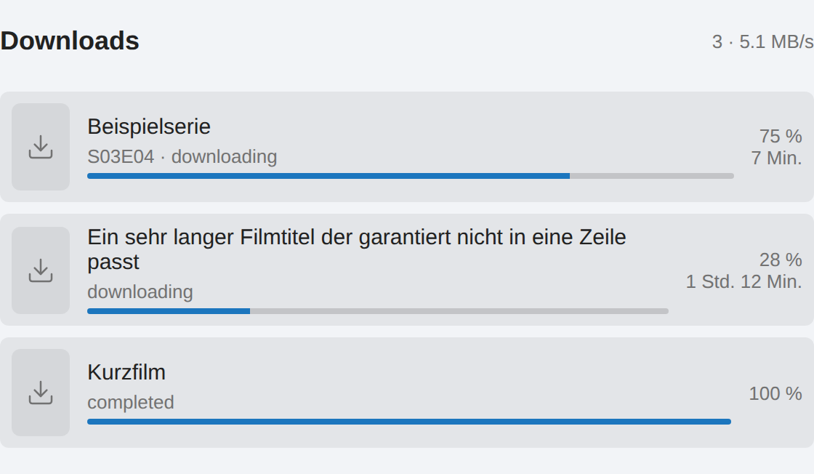
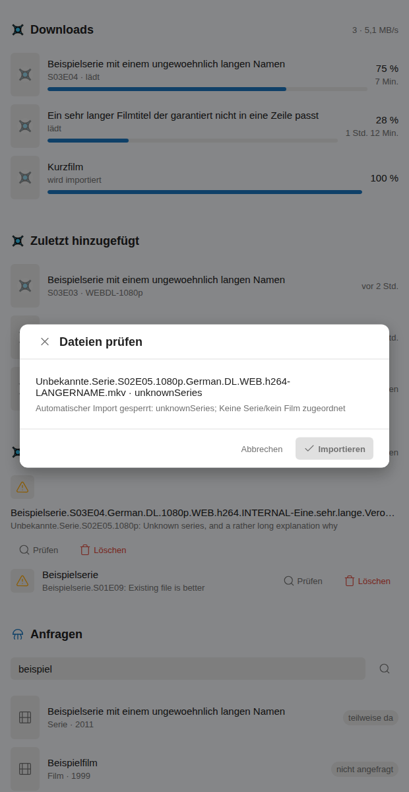
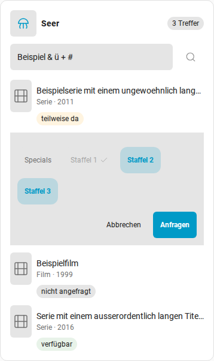
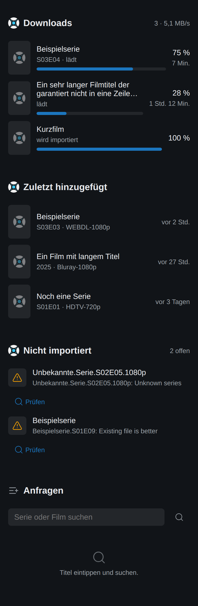

# arrstack Cards

Vier Dashboard-Karten für Home Assistant zur Integration
[**arrstack**](https://github.com/luukkii123/ha-arrstack-integrations):
Downloads, zuletzt hinzugefügte Medien, Import-Reparatur und Anfragen für
Sonarr, Radarr, SABnzbd und Jellyseerr/Seerr.



| Karte | Was sie tut |
| --- | --- |
| `arrstack-downloads-card` | Warteschlange von Sonarr, Radarr oder SABnzbd: Titel, Status, Fortschritt, Restzeit; auf Wunsch mit Postern und weiteren Spalten. Blockierte Importe lassen sich direkt prüfen. |
| `arrstack-recent-card` | Zuletzt in die Bibliothek von Sonarr oder Radarr aufgenommene Titel. |
| `arrstack-fix-card` | Heruntergeladen, aber nicht importiert: zeigt den Grund, prüft die gefundenen Dateien, importiert einzeln oder gesammelt und löscht Einträge samt Download. |
| `arrstack-seer-card` | In Jellyseerr/Seerr nach Serien und Filmen suchen, Staffeln wählen und anfragen. |

Jede Karte ist einzeln nutzbar.

## Voraussetzungen

- Home Assistant 2026.9.3 oder neuer.
- Die Integration **arrstack** ist eingerichtet. Die Karten sprechen nie
  direkt mit den Diensten, sondern fragen die Integration über Home Assistant
  ab; der API-Schlüssel bleibt serverseitig. Ohne passende Instanz zeigt die
  Karte „Kein passender arrstack-Dienst eingerichtet."
- Import-Prüfung und -Aktionen sowie zusätzliche Queue-Spalten brauchen
  arrstack-Integration 0.4.1 oder neuer.
- Die Dienst-Logos in den Kartenköpfen werden von `brands.home-assistant.io`
  geladen; ohne Internet entfallen sie, die Karte funktioniert weiter.

## Installation

**Über HACS**

1. HACS → ⋮ → *Benutzerdefinierte Repositories* → dieses Repository
   hinzufügen, Kategorie **Dashboard**.
2. *arrstack Cards* herunterladen und den Browser hart neu laden
   (Strg+F5), sonst bleibt die alte Datei im Cache.

**Manuell**

1. `dist/arrstack-cards.js` nach `config/www/arrstack-cards.js` kopieren.
2. Unter Einstellungen → Dashboards → ⋮ → Ressourcen die Ressource
   `/local/arrstack-cards.js` vom Typ *JavaScript-Modul* hinzufügen.
3. Browser hart neu laden.

Danach erscheinen die Karten in der Kartenauswahl; der Karteneditor bietet die
eingerichteten arrstack-Instanzen zur Auswahl an. Alle Felder sind dort mit
Beschriftung und Erklärung (deutsch oder englisch, je nach HA-Sprache)
einstellbar, YAML ist optional.

## Gemeinsame Parameter

Gelten für alle vier Karten.

| Schlüssel | Typ | Vorgabe | Bedeutung |
| --- | --- | --- | --- |
| `title` | Text | je Karte (siehe unten) | Überschrift der Karte |
| `entry_id` | Text | leer | Instanz (Konfigurationseintrag) der Integration. Leer: die einzige passende Instanz wird genommen; gibt es mehrere, fordert die Karte zur Auswahl auf. |
| `service` | Text | leer | Diensttyp (`sonarr`, `radarr`, `sabnzbd`, `seerr`), wenn keine Instanz gewählt ist |
| `refresh_seconds` | Zahl 0–600 | je Karte | Sekunden zwischen zwei Abfragen; `0` schaltet das Nachladen ab |
| `max_items` | Zahl | je Karte | Anzahl Zeilen bzw. Einträge pro Seite |

## arrstack-downloads-card

Dienste: Sonarr, Radarr, SABnzbd. Vorgabetitel: „Downloads".
`refresh_seconds` 15 · `max_items` 10 (1–200; weitere Einträge über den
Seitenwechsel).

| Schlüssel | Typ | Vorgabe | Bedeutung |
| --- | --- | --- | --- |
| `show_posters` | Wahrheitswert | `true` | Poster links neben jeder Zeile |
| `show_unknown` | Wahrheitswert | `true` | auch nicht zugeordnete Filme/Serien zeigen, damit Importprobleme sichtbar bleiben |
| `columns` | Liste | `title, status, episode, timeleft, progress` | sichtbare Spalten in dieser Reihenfolge; die Reihenfolge lässt sich im Editor mit Hoch/Runter ändern |

Mögliche Spalten: `title`, `status`, `episode`, `timeleft`, `progress`,
`episode_title`, `episode_air_date`, `languages`, `quality`, `custom_formats`,
`custom_format_score`, `protocol`, `indexer`, `download_client`,
`release_title`, `size`, `output_path`. Fehlende Angaben erscheinen als „—".
Breite Karten zeigen eine Tabelle, schmale eine kompakte Zeile; bei Sonarr und
Radarr öffnet das Prüf-Symbol blockierter Downloads den Importdialog.

```yaml
type: custom:arrstack-downloads-card
title: Downloads
max_items: 5
columns:
  - title
  - status
  - timeleft
  - progress
```

## arrstack-recent-card

Dienste: Sonarr, Radarr. Vorgabetitel: „Zuletzt hinzugefügt".
`refresh_seconds` 120 · `max_items` 8 (1–50). Keine weiteren Parameter.

```yaml
type: custom:arrstack-recent-card
max_items: 6
```

## arrstack-fix-card

Dienste: Sonarr, Radarr. Vorgabetitel: „Import / Probleme" (mit Dienstname
davor, wenn keine eigene Überschrift gesetzt ist). `refresh_seconds` 60 ·
`max_items` 5 (1–50, Einträge pro Seite). Keine weiteren Parameter.



*Prüfen* öffnet einen Dialog mit den gefundenen Dateien. *Importieren* ist nur
aktiv, wenn die Integration den Import als unbedenklich einstuft; sonst steht
der Grund darunter. Erledigte Einträge lassen sich ausgewählt oder gesammelt
(„Bereite importieren") übernehmen. *Löschen* entfernt den Eintrag aus der
Warteschlange **und** die heruntergeladenen Dateien im Download-Client; vorher
folgt eine Rückfrage.

```yaml
type: custom:arrstack-fix-card
max_items: 5
```

## arrstack-seer-card

Dienst: Jellyseerr/Seerr. Vorgabetitel: „Seer". `refresh_seconds` 0 (die Karte
lädt auf Zuruf) · `max_items` 8 (1–20, Treffer). Keine weiteren Parameter.



Ein Treffer blendet die Staffelauswahl direkt darunter ein. Bereits verfügbare
Staffeln sind gesperrt, fehlende vorbelegt. Bei Serien wird die Staffelliste
immer mitgesendet.

```yaml
type: custom:arrstack-seer-card
title: Anfragen
```

## Bedienung und Darstellung

- Dialoge schließen mit Escape, *Schließen* oder Browser-Zurück; ein Klick
  daneben schließt sie nicht. Geänderte Auswahlen werden erst nach
  ausdrücklichem *Verwerfen* verworfen.
- Lange Titel werden einzeilig gekürzt, die Karten passen sich schmalen
  Breiten an (Sections-Layout, Kartengröße ab 6 Spalten).



## Theme-Variablen

Es gibt keine eigenen Variablen. Die Karten übernehmen die Standardvariablen
von Home Assistant: `--primary-text-color`, `--secondary-text-color`,
`--primary-color`, `--secondary-background-color`, `--divider-color`,
`--error-color`, `--success-color`, `--warning-color`, `--ha-card-border-radius`
sowie die `--ha-space-*`- und `--ha-font-*`-Größen. Das gewählte Theme gilt
also auch hier, hell wie dunkel.

## Entwicklung

`dist/arrstack-cards.js` ist Quelltext und Auslieferung zugleich (reines
Vanilla-JS, kein Build, keine Unterordner). Hinweise zu Tests und
Renderprüfung: [docs/entwicklung.md](docs/entwicklung.md).

## Lizenz

MIT, siehe [LICENSE](LICENSE).
